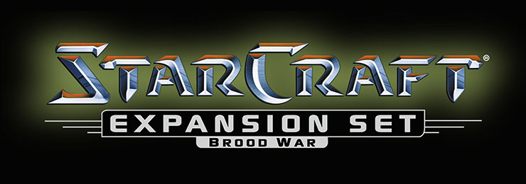

On this page I plan to publish various challenges I have created. I currently only have one challenge here but I have an ambition to create more over time, especially focused on game hacking.

## Starcraft: Brood War - EUD Pwnable

The goal of this challenge is to exploit an old bug in Starcraft: Brood War. It was originally developed for the Midnight Sun 2020 CTF. For a while I also hosted a standalone version here that anyone could play against a live bot. I have since **retired the hosted version** and taken the download offline.

If you want to understand the bug and how the exploit works, I've written it up in detail in [this blog post](/software/2020/04/05/exploiting-starcraft1/).

Solvers of the hosted version:

- 2022-01-26: ZetaTwo

## Challenge Archive

I'm putting together an archive of the CTF challenges I've authored over the years, collected in one place with their source, handouts, and solutions. This Starcraft challenge will be part of it, repackaged so you can run the whole thing locally without any hosted server. I'll link the archive here once it's released.
